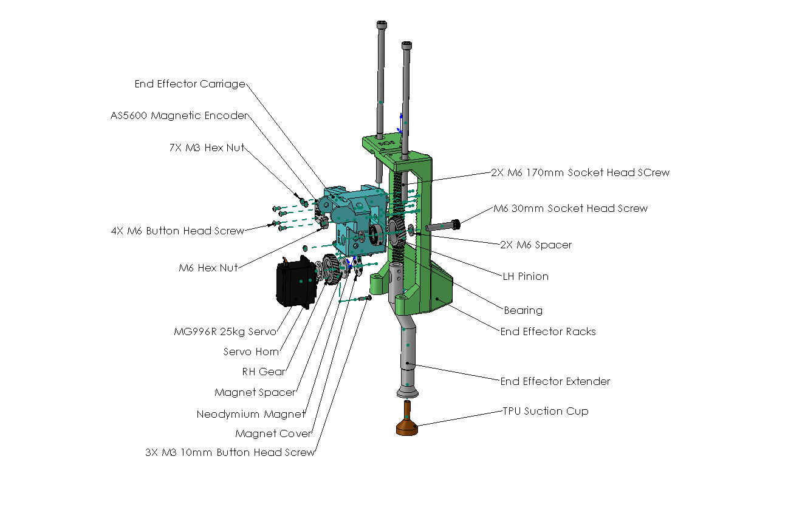

# Othellobot
Othellobot is an automated, 3-axis pick-and-place robotic platform that plays Othello against a human opponent on a physical 8x8 grid.

# Mechanical & Electromechanical Design
The frame is constructed from 2020 extruded aluminum and 1/8" laser-cut cast acrylic sheets. Belt pulley systems coupled with microstepping-enabled stepper motors achieve precise X and Y-axis motion without sensor feedback. The custom Z-axis actuator uses a high-torque 360-degree servo motor and a rack-and-pinion mechanism equipped with a magnetic encoder for accurate vertical positioning. The end-effector uses a TPU-based suction cup connected to a 4.5V DC diaphragm vacuum pump (ZR370-02PM), a solenoid valve and a pressure sensor to reliably manipulate acrylic game tokens. Custom drag chains route along the linear rails to manage wiring.

# PCB & Electronics Design
The playing board integrates 64 individually addressable LEDs beneath a thin layer of PLA. A custom 4-layer PCB facilitates interfacing between the Arduino Nano, Raspberry Pi 4, and the peripheral electronics. The board features:
- TMC5262 Smart Motion Controllers and Stepper Motor drivers
- Dual voltage regulators (dedicated power for the LEDs/servo, and logic-level definition for the TMC5262s)
- Pressure sensor conditioning circuitry
- Centralized interfaces for motors, limit switches, the LED matrix, encoders, the vacuum pump, and the solenoid
- PCBs were soldered and tested by hand (soldering iron, heat gun, multimeter)
- All wires were crimped and managed by hand (JST-PH connectors, Dupont connectors, quick disconnected, ring terminals, zip ties, heat shrinks)
- Power supply is selected to handle worst-case maximum loading

# Communications, AI & Embedded Software

Vision & AI: An OV2643 camera module tracks user moves using OpenCV for image processing (edge detection, centroid placement, image distortion correction, and interpolation). The game logic and opponent decision-making are driven by an AlphaZero reinforcement learning model built in PyTorch running on the Raspberry Pi 4 (or laptop).

Firmware: The Arduino Nano operates on a custom state-machine architecture to transition smoothly between game states.

Driver Integration: The Nano communicates with the TMC5262 drivers via SPI using a completely hand-written software implementation for low-level motor control.

